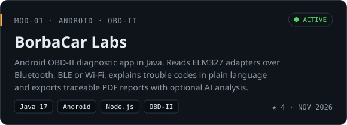
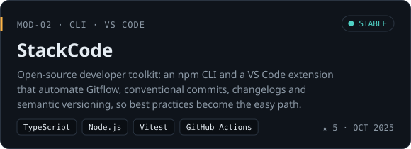
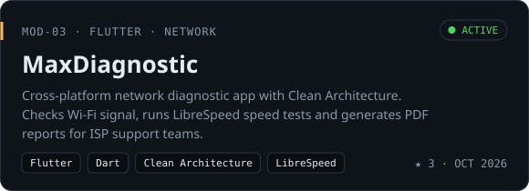
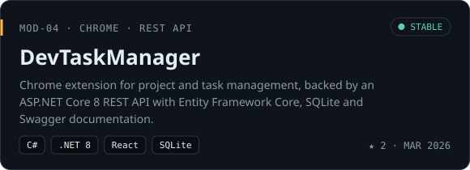
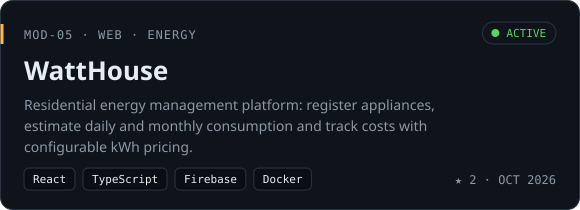
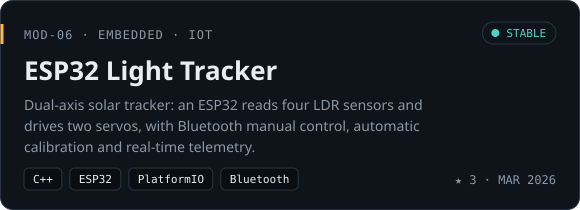

<picture>
  <source media="(prefers-color-scheme: dark)" srcset="https://raw.githubusercontent.com/YagoBorba/YagoBorba/output/header-dark.svg">
  <source media="(prefers-color-scheme: light)" srcset="https://raw.githubusercontent.com/YagoBorba/YagoBorba/output/header-light.svg">
  
</picture>

<p align="center">
  <a href="https://www.linkedin.com/in/yagoborba/">
    <picture>
      <source media="(prefers-color-scheme: dark)" srcset="https://raw.githubusercontent.com/YagoBorba/YagoBorba/output/contact-linkedin-dark.svg">
      <source media="(prefers-color-scheme: light)" srcset="https://raw.githubusercontent.com/YagoBorba/YagoBorba/output/contact-linkedin-light.svg">
      
    </picture>
  </a>
  <a href="mailto:yagoaborba@hotmail.com">
    <picture>
      <source media="(prefers-color-scheme: dark)" srcset="https://raw.githubusercontent.com/YagoBorba/YagoBorba/output/contact-email-dark.svg">
      <source media="(prefers-color-scheme: light)" srcset="https://raw.githubusercontent.com/YagoBorba/YagoBorba/output/contact-email-light.svg">
      
    </picture>
  </a>
  <a href="https://stackoverflow.com/users/18186036/yago-borba">
    <picture>
      <source media="(prefers-color-scheme: dark)" srcset="https://raw.githubusercontent.com/YagoBorba/YagoBorba/output/contact-stackoverflow-dark.svg">
      <source media="(prefers-color-scheme: light)" srcset="https://raw.githubusercontent.com/YagoBorba/YagoBorba/output/contact-stackoverflow-light.svg">
      
    </picture>
  </a>
</p>

## `0x01` About

I'm a backend-focused full-stack developer who likes building reliable systems end to end: REST APIs and integrations, CI/CD pipelines, mobile apps and, now and then, a microcontroller. I study Software Engineering at UGV and have more than two years of hands-on experience across academic, personal and open-source projects, backed by a solid foundation in network infrastructure.

I prefer to understand the problem before thinking about the solution, and I try to learn something new with every line of code.

```yaml
name: Yago Azevedo Borba
role: Full-Stack Developer (backend first)
focus: [API design, systems integration, DevOps, mobile, embedded]
studying: B.Sc. Software Engineering @ UGV
based_in: Santa Catarina, Brazil
```

## `0x02` Current focus

- **BorbaCar Labs**: turning raw OBD-II readings into traceable diagnostics on Android, with an optional Node.js server for AI analysis.
- **StackCode**: evolving [`@stackcode/cli`](https://www.npmjs.com/package/@stackcode/cli) and its VS Code extension to make Gitflow, commits and releases effortless.
- **Studies**: Software Engineering at UGV, with side quests in networking and IoT.

## `0x03` Featured projects

<p align="center">
  <a href="https://github.com/YagoBorba/BorbaCarLabs">
    <picture>
      <source media="(prefers-color-scheme: dark)" srcset="https://raw.githubusercontent.com/YagoBorba/YagoBorba/output/project-borbacarlabs-dark.svg">
      <source media="(prefers-color-scheme: light)" srcset="https://raw.githubusercontent.com/YagoBorba/YagoBorba/output/project-borbacarlabs-light.svg">
      
    </picture>
  </a>
  <a href="https://github.com/YagoBorba/StackCode">
    <picture>
      <source media="(prefers-color-scheme: dark)" srcset="https://raw.githubusercontent.com/YagoBorba/YagoBorba/output/project-stackcode-dark.svg">
      <source media="(prefers-color-scheme: light)" srcset="https://raw.githubusercontent.com/YagoBorba/YagoBorba/output/project-stackcode-light.svg">
      
    </picture>
  </a>
  <a href="https://github.com/YagoBorba/MaxDiagnostic">
    <picture>
      <source media="(prefers-color-scheme: dark)" srcset="https://raw.githubusercontent.com/YagoBorba/YagoBorba/output/project-maxdiagnostic-dark.svg">
      <source media="(prefers-color-scheme: light)" srcset="https://raw.githubusercontent.com/YagoBorba/YagoBorba/output/project-maxdiagnostic-light.svg">
      
    </picture>
  </a>
  <a href="https://github.com/YagoBorba/DevTaskManager">
    <picture>
      <source media="(prefers-color-scheme: dark)" srcset="https://raw.githubusercontent.com/YagoBorba/YagoBorba/output/project-devtaskmanager-dark.svg">
      <source media="(prefers-color-scheme: light)" srcset="https://raw.githubusercontent.com/YagoBorba/YagoBorba/output/project-devtaskmanager-light.svg">
      
    </picture>
  </a>
  <a href="https://github.com/YagoBorba/WattHouse">
    <picture>
      <source media="(prefers-color-scheme: dark)" srcset="https://raw.githubusercontent.com/YagoBorba/YagoBorba/output/project-watthouse-dark.svg">
      <source media="(prefers-color-scheme: light)" srcset="https://raw.githubusercontent.com/YagoBorba/YagoBorba/output/project-watthouse-light.svg">
      
    </picture>
  </a>
  <a href="https://github.com/YagoBorba/ESP32-Light-Tracker">
    <picture>
      <source media="(prefers-color-scheme: dark)" srcset="https://raw.githubusercontent.com/YagoBorba/YagoBorba/output/project-esp32-light-tracker-dark.svg">
      <source media="(prefers-color-scheme: light)" srcset="https://raw.githubusercontent.com/YagoBorba/YagoBorba/output/project-esp32-light-tracker-light.svg">
      
    </picture>
  </a>
</p>

<p align="center"><sub>More in <a href="https://github.com/YagoBorba?tab=repositories">all repositories</a>.</sub></p>

## `0x04` Telemetry

<picture>
  <source media="(prefers-color-scheme: dark)" srcset="https://raw.githubusercontent.com/YagoBorba/YagoBorba/output/telemetry-dark.svg">
  <source media="(prefers-color-scheme: light)" srcset="https://raw.githubusercontent.com/YagoBorba/YagoBorba/output/telemetry-light.svg">
  
</picture>

<picture>
  <source media="(prefers-color-scheme: dark)" srcset="https://raw.githubusercontent.com/YagoBorba/YagoBorba/output/pacman-contribution-graph-dark.svg">
  <source media="(prefers-color-scheme: light)" srcset="https://raw.githubusercontent.com/YagoBorba/YagoBorba/output/pacman-contribution-graph.svg">
  
</picture>

<picture>
  <source media="(prefers-color-scheme: dark)" srcset="https://raw.githubusercontent.com/YagoBorba/YagoBorba/output/footer-dark.svg">
  <source media="(prefers-color-scheme: light)" srcset="https://raw.githubusercontent.com/YagoBorba/YagoBorba/output/footer-light.svg">
  
</picture>
